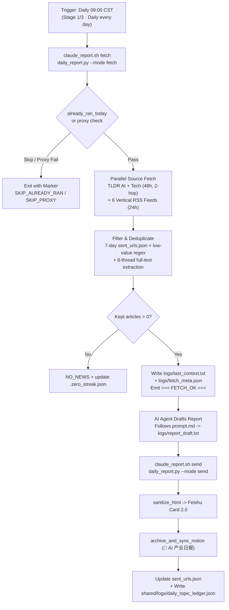

# 🤖 AI Daily News Bot

> [← Back to Daily Bots Root README](../README.md)

**Stage 1 of 3 in the daily `09:00 CST` AI intelligence pipeline.** Collects the past 24–48 hours of global AI models, compute infrastructure, policy, robotics, and commercial milestones, produces a fact-dense Chinese briefing, pushes to Feishu, archives to Notion, and seeds the cross-bot daily topic ledger for downstream bots.

---

## Workflow Architecture



---

## Data Sources & Filtering

| Source | Window | Notes |
| :--- | :--- | :--- |
| **TLDR AI & TLDR Tech** | 48h | Two-hop extraction from newsletter index to original source URLs; strips `(Sponsor)` items |
| **The Verge AI, TechCrunch AI, Wired AI, The Decoder, Ars Technica AI, The Robot Report** | 24h | Vertical AI & robotics feeds; 8-thread `fetch_article_text` full-body extraction with RSS summary fallback |

- **Deduplication**: In-batch normalized `url_key()` dedup + 7-day rolling `logs/sent_urls.json`.
- **Source Health**: Tracks per-feed consecutive zero-yield days in `logs/.zero_streak.json` and emits `=== SOURCE_ALERT ===` after 3 consecutive empty days.
- **Cross-Bot Handoff**: On successful `send`, writes headlines and URLs into `../shared/logs/daily_topic_ledger.json` so `x-hotspot-bot`, `ai-builder-bot`, and `github-hn-bot` do not duplicate identical news.

---

## CLI Usage

```bash
# 1. Fetch articles and write logs/last_context.txt
bash "AI Daily News Bot/claude_report.sh" fetch

# 2. (AI Agent drafts logs/report_draft.txt following prompt.md)

# 3. Push to Feishu, archive to Notion, update ledger
bash "AI Daily News Bot/claude_report.sh" send

# Optional: Force re-run or specify a custom draft file
FORCE_RUN=1 bash "AI Daily News Bot/claude_report.sh" send --file path/to/draft.txt

# Health check (runs at 10:00 via shared/ai_chain_health.sh)
bash "AI Daily News Bot/health_check.sh"
```

---

## Key Files & Environment Variables

- `daily_report.py` — Deterministic fetch, filter, deliver, and ledger writer
- `prompt.md` — Editorial spec (5-star to 3-star ordering, 30-second overview, single-paragraph dense `The Details`, controlled HTML tags)
- `claude_report.sh` / `health_check.sh` / `auto_repair.sh` — Thin wrappers delegating to `../shared/*_base.sh`
- **Env Vars**: `FEISHU_WEBHOOK` (required), `FEISHU_SECRET` (optional), `NOTION_ARCHIVE_API_KEY` & `NOTION_ARCHIVE_DATABASE_ID` (optional), `HTTPS_PROXY` (optional).
