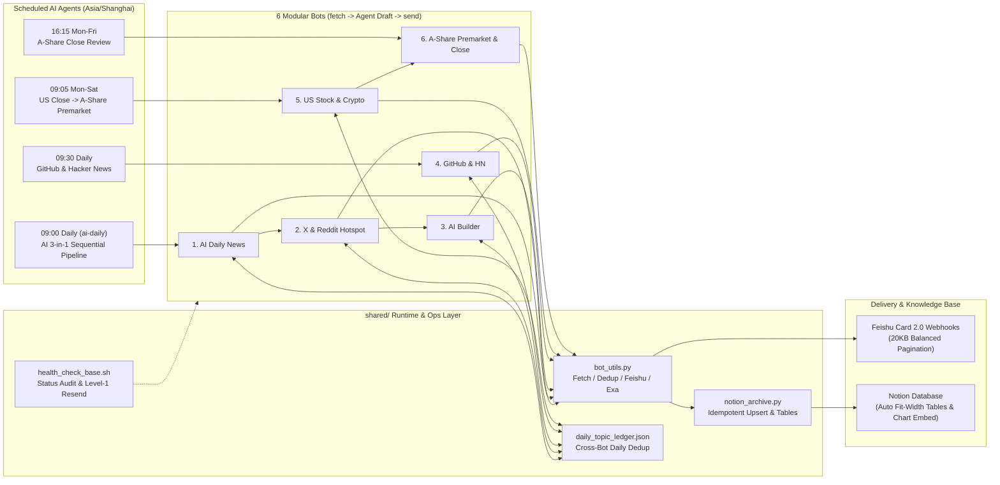

# Daily Bots — Modular AI & Market Intelligence Pipeline

[](https://github.com/shirleyisdoingrightthings/daily-bots/actions/workflows/ci.yml)
[](./LICENSE)
[](https://www.python.org/)

🌐 **English** | [简体中文](./README.zh-CN.md)

A production-tested monorepo of **6 modular automated intelligence bots** (organized into **4 scheduled pipelines**: Morning AI Daily 3-in-1, US Close → A-Share Premarket, GitHub & Hacker News, and A-Share Close Review) + a **shared runtime & ops layer** that collect, deduplicate, verify, and publish daily briefings across **AI Industry News, X & Reddit Debates, AI Builders, GitHub & Hacker News, US Equities & Crypto, and China A-Shares** to **Feishu (Lark) Card 2.0** and **Notion**.

> **Zero LLM Vendor Lock-In**: Every Python script (`*_report.py`) performs deterministic `fetch`, deduplication, sanitization, Feishu delivery, and Notion archiving with zero hardcoded LLM SDK calls. AI editorial drafting is cleanly decoupled into Markdown prompts (`prompt*.md`) and agent workflow specs (`shared/scheduled-tasks/*/SKILL.md`), so you can run it with any coding/automation agent or LLM of your choice.

---

## System Architecture



---

## Bot Directory & Workflow Navigation

Click any module below to inspect its dedicated **workflow diagram, data sources, deduplication gates, CLI modes, and configuration**:

| Module | Schedule (CST) | Coverage & Core Workflow | Workflow Docs |
| :--- | :--- | :--- | :--- |
| 🤖 **AI Daily News Bot** | Daily `09:00` (`ai-daily` 1/3) | Global AI models, infra, policy & robotics via TLDR + 6 vertical RSS feeds with full-text extraction; seeds the cross-bot daily ledger. | [Folder](./AI%20Daily%20News%20Bot/) · [Workflow README](./AI%20Daily%20News%20Bot/README.md) |
| 🐦 **X & Reddit Hotspot Bot** | Daily `09:00` (`ai-daily` 2/3) | 48h Latent Space `[AINews]` full Twitter Recap + Reddit Recap (12 AI subreddits) + Techmeme cross-check; extracts top X debates & hands-on Reddit feedback with primary links. | [Folder](./x-hotspot-bot/) · [Workflow README](./x-hotspot-bot/README.md) |
| 🛠️ **AI Builder Bot** | Daily `09:00` (`ai-daily` 3/3) | Public X List direct fetch via `twitterapi.io` (zero browser/cookie risk) + full X Article & external blog extraction; filters prior stages' posts. | [Folder](./ai-builder-bot/) · [Workflow README](./ai-builder-bot/README.md) |
| 🐙 **GitHub & HN Bot** | Daily `09:30` | GitHub Trending (Mon–Sat Daily / Sun Weekly) with README extraction + Hacker News Top 8 (Firebase + Algolia) + top comments & 30-day memory. | [Folder](./github-hn-bot/) · [Workflow README](./github-hn-bot/README.md) |
| 🗽 **US Stock & Crypto Bot** | Mon–Sat `09:05` (Stage 1/2) | Buy-side quant US close (intraday CLV/RVOL, US2Y/10Y/2s10s, VIX/VIX3M/VRP, balanced 30-stock breadth, duration-neutral HYG-IEI, 220d MA50/MA200/HV20/Z-score) + 24h Crypto with perp funding/OI + today macro actuals, NYSE holiday alerts & 5-day calendar + custom watchlist + Exa verification + auto Notion chart toggle. | [Folder](./us%20stock%20bot/) · [Workflow README](./us%20stock%20bot/README.md) |
| 🇨🇳 **A-Share Stock Bot** | Mon–Fri `09:05–09:30` (Stage 2/2) & `16:15` | A-share-only premarket (chained directly after US close before 09:30, synthesizing previous A-share close, post-close/pre-open domestic policy telegraphs & fresh US report) + 16:15 close review with 220d MA50/MA200/RSI/Bollinger/CLV/RVOL/HV20/Z-score. | [Folder](./a-share-bot/) · [Workflow README](./a-share-bot/README.md) |
| ⚙️ **Shared Runtime & Ops** | Always-on layer | `bot_utils.py`, `notion_archive.py`, `notion_reconcile.py`, `*_base.sh` wrappers, `scheduled-tasks/` `SKILL.md` specs, and 50+ offline unit tests. | [Folder](./shared/) · [Architecture README](./shared/README.md) |

---

## Key Engineering Highlights

- **Strict Fetch / Draft / Send Separation**: Running `claude_report.sh fetch` writes a clean, deterministic context snapshot to `logs/last_context.txt`; an AI agent drafts against `prompt*.md` into `logs/report_draft.txt`; `claude_report.sh send` validates hard gates, pushes to Feishu, archives to Notion, and updates dedup state.
- **Cross-Bot Daily Topic Ledger (`daily_topic_ledger.json`)**: The 09:00 AI pipeline runs strictly in sequence (`AI Daily News → X Hotspot → AI Builder`), followed by `GitHub & HN` at 09:30. Each stage records published URLs, topics, and `x.com` status IDs so downstream bots avoid repeating identical news.
- **Anti-Hallucination Exa Enrichment (Optional, Equity Bots Only)**: For stock movers without RSS/telegraph coverage, `shared/bot_utils.py` batches up to 6 movers into a single Exa Agent check using a strict 3-state schema (`confirmed` / `absent` / `cannot_verify`)—only `confirmed` catalysts enter the context.
- **Resilient Feishu Card 2.0 Delivery**: Controlled HTML whitelist (`<b>` and `<a href>` only), automatic balanced pagination under Feishu's ~20KB payload ceiling with `(n/N)` headers, and partial-send caching (`pending_messages.json`) for zero duplicate resend on retry.
- **Idempotent Notion Archiving & Auto Fit-Width Tables**: Upserts by `(Date, Source, Type)` in place (preserving page URL & comments), converts dense market KPIs into 2-column Notion tables with automatic `fit-page-width` column sizing, falls back cleanly to `curl` on LibreSSL EOF errors, and ships with `shared/notion_reconcile.py` for offline backfill.
- **Cross-Platform Secret Loading**: Works out of the box with `.env` on Linux, macOS, and CI, while optionally supporting macOS LaunchAgent `*.plist` stores via `BOT_PLIST_PREFIX`.

---

## Repository Layout

```text
daily-bots/
├── README.md                      # You are here (English)
├── README.zh-CN.md                # 简体中文主页
├── LICENSE                        # MIT License
├── CONTRIBUTING.md                # Architecture rules & PR checklist
├── requirements.txt               # Unified Python dependencies
├── .env.example                   # Environment configuration template
├── .github/workflows/ci.yml       # Automated syntax + unit test CI
├── docs/
│   ├── tv-dashboard.html          # Interactive TradingView Notion widget (GitHub Pages)
│   └── launchd-env.plist.example  # Optional macOS LaunchAgent template
├── AI Daily News Bot/             # Stage 1: Global AI industry briefing
├── x-hotspot-bot/                 # Stage 2: X & Reddit AI community debates
├── ai-builder-bot/                # Stage 3: Curated AI Builders X List
├── github-hn-bot/                 # GitHub Trending + Hacker News Top 8
├── us stock bot/                  # US Equities Close + 24h Crypto + Custom Watchlist
└── shared/                        # Core Python utilities, Notion sync, shell bases, SKILL.md & tests
```

---

## Quickstart (5 Minutes)

### 1. Clone & Install

```bash
git clone https://github.com/shirleyisdoingrightthings/daily-bots.git
cd daily-bots
pip install -r requirements.txt
```

### 2. Configure Environment

```bash
cp .env.example .env
# Edit `.env` and fill in at least FEISHU_WEBHOOK (or FEISHU_WEBHOOK_CN / FEISHU_WEBHOOK_HK)
```

> Want different Feishu group webhooks per bot? Place a `.env` file inside any individual bot folder (e.g., `github-hn-bot/.env`); bot-local `.env` overrides repo-root `.env`.

### 3. Run a Single Bot End-to-End

```bash
# Step 1: Fetch deterministic source context -> writes logs/last_context.txt
bash "AI Daily News Bot/claude_report.sh" fetch

# Step 2: Draft report following `AI Daily News Bot/prompt.md`
#         and save output to `AI Daily News Bot/logs/report_draft.txt`

# Step 3: Sanitize, deliver to Feishu, archive to Notion, update dedup state
bash "AI Daily News Bot/claude_report.sh" send
```

For full automated scheduling with an AI agent, point your scheduler at the specs in [`shared/scheduled-tasks/`](./shared/scheduled-tasks/README.md).

---

## Environment Variables Reference

| Variable | Required By | Description |
| :--- | :--- | :--- |
| `FEISHU_WEBHOOK` | All bots | Feishu (Lark) custom bot webhook URL |
| `FEISHU_SECRET` | Optional (all bots) | Feishu webhook HMAC signing secret |
| `TWITTERAPI_IO_KEY` | AI Builder | API key from [twitterapi.io](https://twitterapi.io/) for public X List fetching |
| `X_LIST_ID` | AI Builder | Numeric X List ID or full `https://x.com/i/lists/<id>` URL |
| `NOTION_ARCHIVE_API_KEY` | Optional (all bots) | Notion Internal Integration token for daily archiving |
| `NOTION_ARCHIVE_DATABASE_ID` | Optional (all bots) | Target Notion database ID |
| `WATCHLIST_FILE` | Optional (US Stock & Crypto) | Custom path to private stratified `watchlist.json` |
| `EXA_API_KEY` / `ENABLE_EXA_ENRICH` | Optional (US Stock & Crypto) | Set `ENABLE_EXA_ENRICH=1` to verify uncovered stock catalysts via Exa |
| `EXA_AGENT_EFFORT` | Optional (Exa) | Fixed effort tier: `minimal` / `low` / `medium` (default) / `high` |
| `COINGECKO_API_KEY` / `CMC_API_KEY` | Optional (US Stock & Crypto) | Optional keys for higher crypto quote / Fear & Greed rate limits |
| `HTTP_PROXY` / `HTTPS_PROXY` | Optional (all bots) | Local proxy URL if direct outbound network access is restricted |
| `BOT_PLIST_PREFIX` | Optional (macOS only) | Prefix for `~/Library/LaunchAgents/<prefix>.<bot-id>.plist` |

---

## Testing & Operations

All unit tests run completely offline with zero external network calls:

```bash
# Run full offline test suite
python3 -m unittest discover -s shared/tests -v

# Preview any locally archived reports missing from Notion (dry-run)
python3 shared/notion_reconcile.py --dry-run

# Run sequential health audit for the AI 3-in-1 chain
bash shared/ai_chain_health.sh
```

---

## Contributing & License

- Contributions are welcome—see [CONTRIBUTING.md](./CONTRIBUTING.md) for architecture rules and PR checks.
- Released under the [MIT License](./LICENSE).
