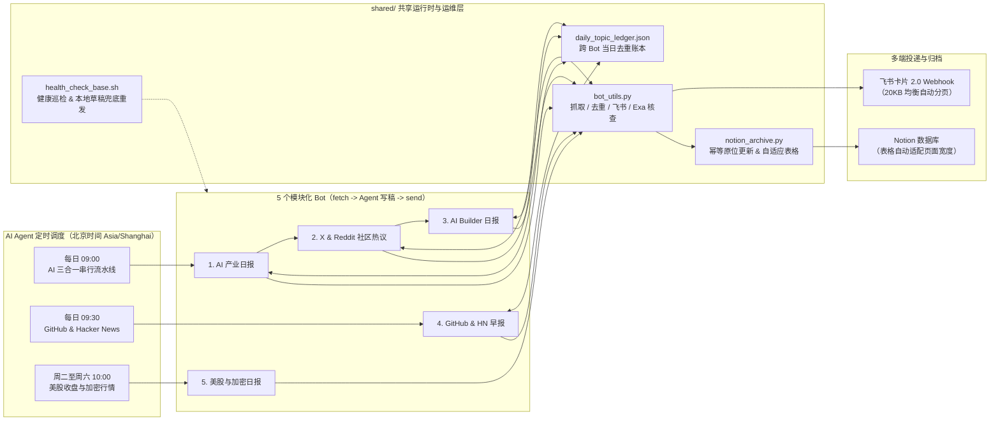

# Daily Bots — 模块化 AI 与金融市场情报流水线

[](https://github.com/shirleyisdoingrightthings/daily-bots/actions/workflows/ci.yml)
[](./LICENSE)
[](https://www.python.org/)

🌐 [English](./README.md) | **简体中文**

一个经过生产环境长期验证的 Monorepo，包含 **5 个模块化自动情报机器人**（编排为 **3 条定时流水线**：早间 AI 三合一、GitHub & Hacker News、美股与加密行情）与一套 **共享运行时及运维层**，每日自动完成抓取、去重、事实核验，并推送至 **飞书（Lark）卡片 2.0** 与 **Notion 知识库**。

> **零大模型厂商锁定（Zero LLM Vendor Lock-In）**：所有 Python 脚本（`*_report.py`）均只负责确定性的 `fetch` 抓取、去重、HTML 清洗、飞书推送与 Notion 归档，不硬编码任何第三方大模型 SDK。AI 写稿完全解耦为 Markdown 规范（`prompt*.md`）与定时调度说明书（`shared/scheduled-tasks/*/SKILL.md`），可自由搭配任意编程/自动化 Agent 与模型运行。

---

## 系统架构



---

## 模块导航与工作流文档

点击任意模块查看专属的 **流程图、数据源清单、去重闸门、CLI 用法与配置说明**：

| 模块 | 定时节奏（北京时间） | 覆盖范围与核心机制 | 工作流文档 |
| :--- | :--- | :--- | :--- |
| 🤖 **AI 产业日报** | 每日 `09:00`（第 1/3 棒） | TLDR AI + 6 个垂直 AI 媒体 RSS + 正文全文提取，覆盖全球大模型、算力基建、政策与机器人；负责播种当日跨 Bot 去重账本。 | [目录](./AI%20Daily%20News%20Bot/) · [工作流文档](./AI%20Daily%20News%20Bot/README.md) |
| 🐦 **X & Reddit 社区热议** | 每日 `09:00`（第 2/3 棒） | 48 小时窗口，完整提取 Latent Space `[AINews]` 的 Twitter Recap + Reddit Recap（12 个核心 AI subreddit）与 Techmeme 交叉验证；保留正反技术交锋、一线实测吐槽与原帖直链。 | [目录](./x-hotspot-bot/) · [工作流文档](./x-hotspot-bot/README.md) |
| 🛠️ **AI Builder 日报** | 每日 `09:00`（第 3/3 棒） | 通过 `twitterapi.io` 直连抓取公开自建 X List（零浏览器/Cookie 封号风险）+ 自动拉取 X Article 长文与外链博客正文；自动过滤前序已播原推。 | [目录](./ai-builder-bot/) · [工作流文档](./ai-builder-bot/README.md) |
| 🐙 **GitHub & HN 早报** | 每日 `09:30` | GitHub Trending（周一至周六日榜 / 周日周榜）+ README 自动抓读 + Hacker News Top 8（Firebase + Algolia 热评融合）及 30 天跨天在榜记忆。 | [目录](./github-hn-bot/) · [工作流文档](./github-hn-bot/README.md) |
| 🗽 **美股与加密日报** | 周二至周六 `10:00` | 跨资产美股收盘（四大股指、10Y 美债、VIX、美元、黄金、布油、SOX/HYG、均线与 RSI/布林 %B）+ 24h 加密行情 + Nasdaq 财报/宏观日程 + 自定义分层自选股 + 可选 Exa 异动催化核查。 | [目录](./us%20stock%20bot/) · [工作流文档](./us%20stock%20bot/README.md) |
| ⚙️ **共享运行时与运维层** | 底层常驻 | `bot_utils.py`、`notion_archive.py`、`notion_reconcile.py`、`*_base.sh` 统一入口、`scheduled-tasks/` `SKILL.md` 调度规范及 45+ 离线单元测试。 | [目录](./shared/) · [架构说明](./shared/README.md) |

---

## 核心工程亮点

- **严格的 `fetch / draft / send` 三段解耦**：运行 `claude_report.sh fetch` 生成确定性的上下文快照并落盘到 `logs/last_context.txt`；AI Agent 按 `prompt*.md` 写稿至 `logs/report_draft.txt`；`claude_report.sh send` 执行硬闸门校验、飞书投递、Notion 归档与去重状态落盘。
- **跨 Bot 当日去重账本（`daily_topic_ledger.json`）**：早间 09:00 AI 流水线严格串行（`AI 产业日报 → X & Reddit 社区热议 → AI Builder`），随后 09:30 运行 `GitHub & HN`。前序 Bot 推送成功后写入已播 URL、话题标题与 `x.com` / `reddit.com` 原帖链接，下游自动避重。
- **防幻觉 Exa 定向补盲（可选，仅限股票类 Bot）**：针对免费 RSS 与快讯未覆盖的领涨领跌异动股，`shared/bot_utils.py` 单次批量核查最多 6 只标的，强制返回三态 Schema（`confirmed` / `absent` / `cannot_verify`），仅放行 `confirmed` 真实催化。
- **高可靠飞书卡片 2.0 投递**：HTML 白名单清洗（仅保留 `<b>` 与 `<a href>`），严格遵守飞书约 20KB 单卡上限自动均衡分页并附 `(n/N)` 页码，配合 `pending_messages.json` 断点续发避免重复推送。
- **幂等 Notion 归档与表格自适应宽度**：按 `(Date, Source, Type)` 原位 Upsert（保留页面 URL 与评论），自动将高频金融指标转为 2 列 Notion 表格并触发 `fit-page-width` 列宽适配，遇到 LibreSSL EOF 错误时平滑回退 `curl`，并附带 `shared/notion_reconcile.py` 支持离线漏归档补录。
- **跨平台凭据加载**：在 Linux、macOS 与 CI 环境均可通过 `.env` 开箱即用，同时可选支持通过 `BOT_PLIST_PREFIX` 读取 macOS LaunchAgent `*.plist` 环境变量。

---

## 仓库目录结构

```text
daily-bots/
├── README.md                      # English Homepage
├── README.zh-CN.md                # 当前页面（简体中文主页）
├── LICENSE                        # MIT 开源协议
├── CONTRIBUTING.md                # 架构规范与 PR 自检清单
├── requirements.txt               # 统一 Python 依赖
├── .env.example                   # 环境变量配置模板
├── .github/workflows/ci.yml       # GitHub Actions 语法与单元测试 CI
├── docs/
│   ├── tv-dashboard.html          # Notion 嵌入式 TradingView 交互看板（GitHub Pages）
│   └── launchd-env.plist.example  # 可选 macOS LaunchAgent 配置模板
├── AI Daily News Bot/             # 第 1 棒：全球 AI 产业日报
├── x-hotspot-bot/                 # 第 2 棒：X & Reddit 社区热议
├── ai-builder-bot/                # 第 3 棒：一线 AI Builder X List 日报
├── github-hn-bot/                 # GitHub Trending + Hacker News Top 8
├── us stock bot/                  # 美股收盘 + 24h 加密 + 自定义自选股仪表盘
└── shared/                        # 共享工具库、Notion 归档、Shell 底座、SKILL.md 与单测
```

---

## 5 分钟快速上手

### 1. 克隆并安装依赖

```bash
git clone https://github.com/shirleyisdoingrightthings/daily-bots.git
cd daily-bots
pip install -r requirements.txt
```

### 2. 配置环境变量

```bash
cp .env.example .env
# 编辑 `.env`，至少填入 FEISHU_WEBHOOK（或 A股/港股的 FEISHU_WEBHOOK_CN / FEISHU_WEBHOOK_HK）
```

> 需要为不同 Bot 配置不同的飞书群 Webhook？在对应 Bot 子目录下新建 `.env`（如 `github-hn-bot/.env`），子目录配置会自动覆盖仓库根目录的 `.env`。

### 3. 端到端试跑单个 Bot

```bash
# 第 1 步：确定性抓取当日素材 -> 输出并落盘至 logs/last_context.txt
bash "AI Daily News Bot/claude_report.sh" fetch

# 第 2 步：让你的 AI Agent 阅读 `AI Daily News Bot/prompt.md` 与 `logs/last_context.txt`
#         将成稿写入 `AI Daily News Bot/logs/report_draft.txt`

# 第 3 步：执行清洗校验、推送飞书、归档 Notion 并更新跨天去重记录
bash "AI Daily News Bot/claude_report.sh" send
```

如需接入 AI Agent 自动定时调度，请将调度器指向 [`shared/scheduled-tasks/`](./shared/scheduled-tasks/README.md) 中的规范文件。

---

## 环境变量参考

| 变量名 | 使用模块 | 说明 |
| :--- | :--- | :--- |
| `FEISHU_WEBHOOK` | 全部模块 | 飞书自定义机器人 Webhook 地址 |
| `FEISHU_SECRET` | 可选（全部模块） | 飞书 Webhook HMAC 签名密钥 |
| `TWITTERAPI_IO_KEY` | AI Builder | [twitterapi.io](https://twitterapi.io/) API Key，用于免登抓取公开 X List |
| `X_LIST_ID` | AI Builder | 数字 List ID 或完整 `https://x.com/i/lists/<id>` 链接 |
| `NOTION_ARCHIVE_API_KEY` | 可选（全部模块） | Notion 内部集成 Token，用于每日自动归档 |
| `NOTION_ARCHIVE_DATABASE_ID` | 可选（全部模块） | 目标 Notion 数据库 ID |
| `WATCHLIST_FILE` | 可选（美股与加密） | 自定义本地分层自选股 JSON 路径（默认 `watchlist.json`） |
| `EXA_API_KEY` / `ENABLE_EXA_ENRICH` | 可选（美股与加密） | 设 `ENABLE_EXA_ENRICH=1` 开启未覆盖异动股 Exa 核查 |
| `EXA_AGENT_EFFORT` | 可选（Exa） | 固定档位：`minimal` / `low` / `medium`（默认） / `high` |
| `COINGECKO_API_KEY` / `CMC_API_KEY` | 可选（美股与加密） | 可选 Key，用于提升加密行情与恐贪指数接口限额 |
| `HTTP_PROXY` / `HTTPS_PROXY` | 可选（全部模块） | 网络受限环境下的本地代理地址 |
| `BOT_PLIST_PREFIX` | 可选（仅 macOS） | 对应 `~/Library/LaunchAgents/<prefix>.<bot-id>.plist` 前缀 |

---

## 测试与运维命令

所有单元测试完全离线运行，不发起任何外部网络请求：

```bash
# 运行完整离线单元测试套件
python3 -m unittest discover -s shared/tests -v

# 预览本地已归档但 Notion 漏同步的报告（dry-run，不实际写入）
python3 shared/notion_reconcile.py --dry-run

# 运行 AI 三合一流水线健康巡检
bash shared/ai_chain_health.sh
```

---

## 贡献与开源协议

- 欢迎提交 Issue 与 PR，请先阅读 [CONTRIBUTING.md](./CONTRIBUTING.md) 中的架构约束与自检清单。
- 本项目基于 [MIT License](./LICENSE) 开源发布。
