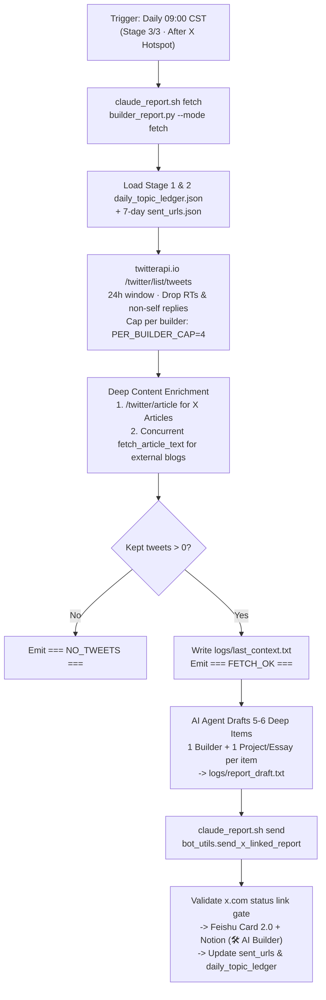

# 🛠️ AI Builder Bot

> [← Back to Daily Bots Root README](../README.md)

**Stage 2 of 3 in the daily `09:00 CST` AI intelligence pipeline (`🔥 X 热点 & AI Builder`).** Monitors a curated public X List (64+ frontier lab leaders, researchers, and frontline builders) via **`twitterapi.io`** (zero browser automation, zero account-ban risk) using **Hacker News–style high-like & high-reply discussion scoring**, concurrently fetches ad-filtered Relevance top replies (`/twitter/tweet/replies/v2`, capping author self-replies at 1), expands X Articles and external engineering blogs, suppresses `ICYMI`/`Resurfacing`/repeat-URL reposts, and publishes unified X hotspot + builder discussion briefings.

---

## Workflow Architecture



---

## Data Pipeline & Enrichment

- **Primary Source**: `https://api.twitterapi.io/twitter/list/tweets` querying your public `X_LIST_ID` (no X cookies or headless browsers).
- **Noise Controls**:
  - Filters out retweets and replies to other users (preserves self-threads & quote tweets).
  - Caps each builder at `BUILDER_PER_ACCOUNT_CAP=4` tweets per run so high-volume accounts do not crowd out quiet builders.
  - Code-level deduplication against `shared/logs/daily_topic_ledger.json` (`urls` and `x_status_ids`) plus 7-day `logs/sent_urls.json`.
- **Full-Text Enrichment**:
  - Automatically detects X Articles and fetches complete article bodies via `/twitter/article`.
  - Concurrently fetches external engineering blog posts / docs referenced in tweets via `shared/bot_utils.fetch_article_text`.

---

## CLI Usage

```bash
# Read-only connectivity test (verifies TWITTERAPI_IO_KEY & X_LIST_ID without touching logs)
bash ai-builder-bot/claude_report.sh test-list

# 1. Fetch past 24h tweets + X Articles + external blog excerpts
bash ai-builder-bot/claude_report.sh fetch

# 2. (AI Agent drafts logs/report_draft.txt following prompt.md)

# 3. Push to Feishu, archive to Notion, record dedup ledger
bash ai-builder-bot/claude_report.sh send

# Archive an existing draft to Notion & update dedup without re-sending Feishu
bash ai-builder-bot/claude_report.sh archive-only

# Health check (runs at 10:00 via shared/ai_chain_health.sh)
bash ai-builder-bot/health_check.sh
```

---

## Key Files & Environment Variables

- `builder_report.py` — `twitterapi.io` client, X Article & external blog enrichment, CLI (`fetch` / `send` / `test-list` / `archive-only`)
- `prompt.md` — Editorial spec (one builder + one concrete project per item, no duplicate links between inline body and footer `原推：`)
- **Required Env Vars**: `TWITTERAPI_IO_KEY`, `X_LIST_ID`, `FEISHU_WEBHOOK`
- **Optional Env Vars**: `BUILDER_WINDOW_H` (`24`), `BUILDER_PER_ACCOUNT_CAP` (`4`), `BUILDER_LIST_SCAN_LIMIT` (`200`), `BUILDER_INCLUDE_REPLIES` (`0`), `NOTION_ARCHIVE_API_KEY`, `NOTION_ARCHIVE_DATABASE_ID`, `HTTPS_PROXY`.
