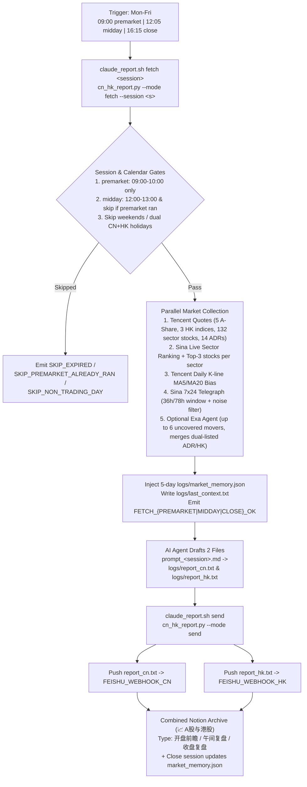

# 📈 China A-Share & Hong Kong Stock Bot

> [← Back to Daily Bots Root README](../README.md)

**Runs Mon–Fri across 3 market sessions (`09:00` Premarket · `12:05` Midday Fallback · `16:15` Close).** Produces synchronized **A-Share** and **Hong Kong** intelligence dashboards—sharing the same 5-section decision framework as the US Stock Bot—and routes them to two independent Feishu group bots (`FEISHU_WEBHOOK_CN` and `FEISHU_WEBHOOK_HK`) plus a unified Notion archive.

---

## Workflow Architecture



---

## Session Design & Smart Gates

| Session | Schedule (CST) | Active Window | Purpose & Gate Logic |
| :--- | :--- | :--- | :--- |
| **`premarket`** | Mon–Fri `09:00` | `09:00–10:00` | Overnight US/ADR mapping, prior technical anchor, morning 7x24 telegraph. Auto-skips after `10:00` (`=== SKIP_EXPIRED ===`) so stale wakeups never fire mid-session. |
| **`midday`** | Mon–Fri `12:05` | `12:00–13:00` | **Smart morning fallback**: auto-skips (`=== SKIP_PREMARKET_ALREADY_RAN ===`) if `premarket` already succeeded today; otherwise summarizes the morning half-day close and afternoon outlook. |
| **`close`** | Mon–Fri `16:15` | Post-close | Full-day A-Share (15:00) & HK (16:00) close review with dynamic Top 3 gaining/losing sectors, sector leaders/laggards, core narrative, and decision signals. Updates 5-day `market_memory.json`. |

---

## Data Sources & Optional Exa Enrichment

- **Quotes & Sector Breadth**: Tencent Finance (`qt.gtimg.cn`) covering 5 A-Share indices + 12 themes (72 stocks), 3 HK indices + 10 sectors (60 stocks), and 14 overnight US/China ADR benchmarks.
- **Dynamic Industry Leaderboard**: Sina Finance live sector rankings (`newSinaHy.php`) plus top-3 moving stocks inside each leading/lagging sector.
- **Technical Anchors**: Tencent daily K-line (`fqkline`) calculating MA5/MA10/MA20 and MA5 bias percentage.
- **7x24 Telegraph**: Sina Finance live wire (`tag_id=10/4/0`) with strict recency filtering (36h standard, 78h Monday morning), deduplication, and high-signal retention.
- **Optional Exa Enrichment (`ENABLE_EXA_ENRICH=1`)**: Merges dual-listed ADR/HK entities (e.g., `NTES / 09999.HK`), verifies catalysts for up to 6 uncovered movers in a single Exa Agent batch, and checks missing key macro events (e.g., LPR / Hang Seng quarterly review).

---

## CLI Usage

```bash
# Fetch by session (premarket | midday | close)
bash cn-hk-stock-bot/claude_report.sh fetch premarket
bash cn-hk-stock-bot/claude_report.sh fetch midday
bash cn-hk-stock-bot/claude_report.sh fetch close

# Send (auto-reads session from logs/fetch_meta.json, or pass explicitly)
bash cn-hk-stock-bot/claude_report.sh send

# Force bypass time window for manual testing
FORCE_RUN=1 bash cn-hk-stock-bot/claude_report.sh fetch close

# Health check (runs weekdays at 17:15)
bash cn-hk-stock-bot/health_check.sh
```

---

## Key Files & Environment Variables

- `cn_hk_report.py` — Multi-session market/telegraph/Exa collector, calendar/window gates, dual-channel Feishu sender, and Notion archiver
- `prompt_premarket.md` / `prompt_midday.md` / `prompt_close.md` — Session-specific editorial templates
- **Required Env Vars**: `FEISHU_WEBHOOK_CN`, `FEISHU_WEBHOOK_HK`
- **Optional Env Vars**: `FEISHU_SECRET_CN`, `FEISHU_SECRET_HK`, `ENABLE_EXA_ENRICH` (`0`/`1`), `EXA_API_KEY`, `EXA_AGENT_EFFORT` (`medium`), `NOTION_ARCHIVE_API_KEY`, `NOTION_ARCHIVE_DATABASE_ID`, `HTTPS_PROXY`.
