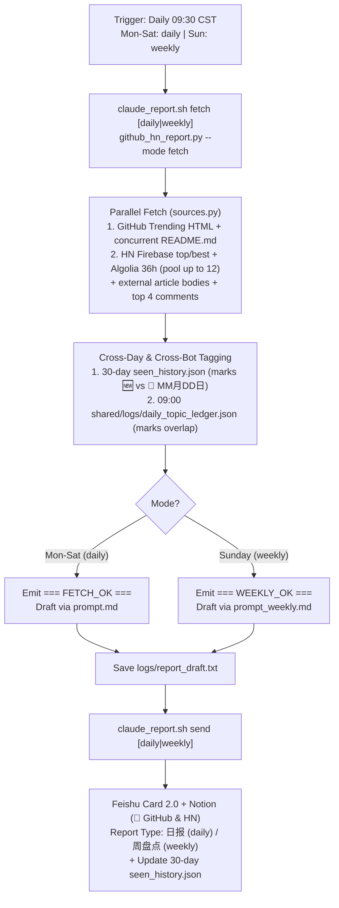

# 🐙 GitHub Trending & Hacker News Bot

> [← Back to Daily Bots Root README](../README.md)

**Stage 3 of 3 in the daily `09:00 CST` `ai-daily` sequential pipeline.** Pairs **GitHub Trending** (full-page fresh-first discovery + Python/TypeScript fallback + compact recurring toggle; Sunday Weekly mode with "Sustained Trend" spotlight) with **Hacker News Top 8** (parallel Firebase `top`/`best` + Algolia 36h/frontpage scores + reply-weighted top comments), reading Stages 1–2 `daily_topic_ledger.json` with zero wake-up race and recording only actually published URLs in `seen_history.json`.

---

## Workflow Architecture



---

## Data Sources & Deduplication

1. **GitHub Trending (`sources.py`)**:
   - Scrapes `https://github.com/trending?since=daily` (or `weekly` on Sundays).
   - Concurrently downloads `raw.githubusercontent.com/<owner>/<repo>/HEAD/README.md`, strips badge clutter and HTML noise, and feeds clean architectural summaries to the drafting prompt.
2. **Hacker News (`sources.py`)**:
   - Combines Firebase `topstories` + `beststories` with Algolia 36h / `front_page` signals into a candidate pool of up to 12 stories (top 8 published + 4 backfill candidates).
   - Extracts linked article text via `shared/bot_utils.fetch_article_text` and top 4 high-signal discussion comments.
3. **30-Day Memory & 09:00 Ledger Alignment**:
   - Stores canonical repo URLs and HN `item?id=` keys in `logs/seen_history.json` (30-day rolling window) so recurring items are labeled with their first-seen date (`🔁 见 MM月DD日 推送`) and collapsed to a 1-line recap.
   - Reads `shared/logs/daily_topic_ledger.json` written by the 09:00 AI pipeline so overlapping HN stories are either replaced from the Top 9–12 backfill pool or folded cleanly.

---

## CLI Usage

```bash
# Auto-detect daily (Mon-Sat) vs weekly (Sun)
bash github-hn-bot/claude_report.sh fetch
bash github-hn-bot/claude_report.sh send

# Explicitly override mode
FORCE_RUN=1 bash github-hn-bot/claude_report.sh fetch weekly
FORCE_RUN=1 bash github-hn-bot/claude_report.sh send weekly

# Health check (runs at 10:30)
bash github-hn-bot/health_check.sh
```

---

## Key Files & Environment Variables

- `sources.py` — GitHub Trending scraper, README fetcher, HN Firebase + Algolia aggregator, comment extractor
- `github_hn_report.py` — History tagging, ledger cross-check, Feishu push, and Notion archiving (`日报` / `周盘点`)
- `prompt.md` / `prompt_weekly.md` — Plain-language editorial templates (GitHub: *"What it does"* + *"Personal Build angle"*; HN: *"What it's about"* + *"What comments are debating"*)
- **Env Vars**: `FEISHU_WEBHOOK` (required), `NOTION_ARCHIVE_API_KEY` & `NOTION_ARCHIVE_DATABASE_ID` (optional), `HTTPS_PROXY` (optional).
