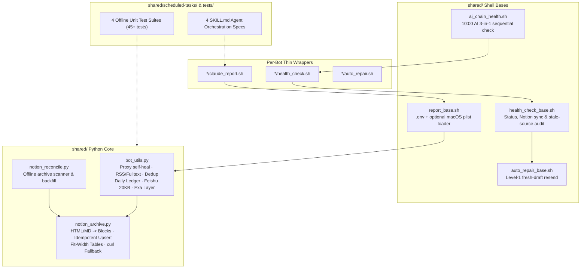

# ⚙️ Shared Runtime, Notion Sync & Automation Layer

> [← Back to Daily Bots Root README](../README.md)

The central shared infrastructure used by all 6 bots in `daily-bots`. Every bot imports this layer dynamically relative to its own script location (`Path(__file__).resolve().parent.parent / "shared"`), keeping the entire monorepo portable across machines and operating systems.

---

## Architecture Overview



---

## Component Breakdown

| File / Directory | Purpose |
| :--- | :--- |
| **`bot_utils.py`** | Core shared Python runtime: proxy port/TUN auto-healing, RSS & full-text extraction, 7-day URL deduplication (`sent_urls.json`), cross-bot `daily_topic_ledger.json`, controlled HTML sanitization, Feishu Card 2.0 ~20KB balanced pagination, `send_x_linked_report` hard gate, Exa REST/Agent enrichment helpers (`exa_fetch_contents`, `exa_search_fallback`, `exa_agent_verify_catalysts`), structured logging (`run.log` + `run.jsonl`), and source zero-streak tracking. |
| **`notion_archive.py`** | Converts Feishu/HTML drafts into structured Notion blocks (including automatic 2-column KPI tables with `fit-page-width` sizing), performs idempotent in-place upserts by `(Date, Source, Type)` without breaking page URLs or comments, handles HTTP 429 `Retry-After`, and transparently falls back to `curl` on LibreSSL EOF errors. Configured via `NOTION_ARCHIVE_API_KEY` and `NOTION_ARCHIVE_DATABASE_ID`. |
| **`notion_reconcile.py`** | Scans local `*/logs/archive/` drafts against `run.jsonl` to find and backfill any reports whose Notion sync previously failed (`--dry-run` supported). |
| **`report_base.sh`** | Unified entrypoint sourced by all 6 `*/claude_report.sh` wrappers. Loads env vars in priority order: shell env → bot-local `.env` → optional macOS LaunchAgent plist (`BOT_PLIST_PREFIX`) → `shared/.env` → repo-root `.env`. |
| **`health_check_base.sh` & `auto_repair_base.sh`** | Lightweight post-run audit verifying `[OK]` / `[NO_NEWS]` / `[MISSING]` / `[FAIL]`, checking `notion_ok=false` sync gaps and stale RSS sources, and performing Level-1 non-AI resend when local drafts are fresh (`ENABLE_CLAUDE_REPAIR=0`, `ENABLE_HEADLESS_CATCHUP=0`). |
| **`ai_chain_health.sh`** | Sequential 10:00 health audit covering `AI Daily News Bot` → `x-hotspot-bot` → `ai-builder-bot` with per-stage timeout guards. |
| **[`scheduled-tasks/`](./scheduled-tasks/README.md)** | Version-controlled `SKILL.md` agent scheduling specs for all 6 bots. |
| **`tests/`** | Fully offline `unittest` suite (`test_exa_enrichment.py`, `test_notion_archive.py`, `test_notion_reconcile.py`, `test_date_and_type_alignment.py`). |

---

## Common Operations

```bash
# Run the full offline test suite
python3 -m unittest discover -s shared/tests -v

# Audit locally archived drafts needing Notion sync (dry-run)
python3 shared/notion_reconcile.py --dry-run

# Backfill failed Notion archives
python3 shared/notion_reconcile.py

# Run sequential health check for the AI 3-in-1 pipeline
bash shared/ai_chain_health.sh
```
