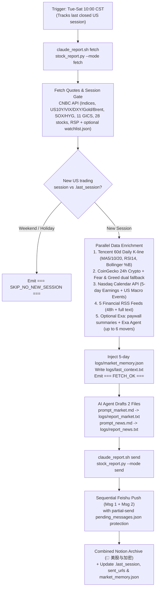

# 🗽 US Stock & Crypto Close Bot

> [← Back to Daily Bots Root README](../README.md)

**Runs Tue–Sat at `10:00 CST` (following each US market close).** Generates a unified two-message briefing:
1. **Message 1 — US Close & 24h Crypto Dashboard**: Cross-asset core indices (4 major US indices + US10Y, VIX, DXY, Gold, Brent Crude, BTC), market breadth (11 GICS sectors, 28 core weights, `RSP` & `RSP-SPX` spread, `SOX`, `HYG`), technical trend & short-term overbought/oversold signals (MA5/MA10/MA20 bias, Wilder `RSI(14)`, Bollinger Bands `%B(20,2)`), consolidated 24h crypto metrics (`Fear & Greed`, total cap, BTC dominance, `BTC/ETH/BNB/SOL/XRP/HYPE`), upcoming 5-day **Financial Events** (major earnings + US macro calendar), optional **Custom Stratified Watchlist**, top 3 gaining/losing sectors & leaders, and a structured Decision Signal Dashboard.
2. **Message 2 — US Market Headlines**: Priority-ranked (5-star to 3-star) news briefing mirroring the AI Daily News format.

---

## Workflow Architecture



---

## Custom Watchlist Feature & Selection Methodology

This bot supports an optional, local, **stratified custom watchlist** that automatically merges into CNBC batch quote fetching, prioritizes upcoming earnings alerts (`★`), appends a 1-line summary to the top KPI table, and renders a dedicated grouped breakdown table right below it.

### Quick Setup (Private & Git-Ignored)
1. Copy [`watchlist.example.json`](./watchlist.example.json) to `watchlist.json` (or point `WATCHLIST_FILE` to any custom JSON path).
2. `watchlist.json` is listed in `.gitignore` so your personal holdings/watchlist never get committed to GitHub.
3. If `watchlist.json` is absent, the bot runs normally without watchlist sections.

### Example Methodology: Jensen Huang's "AI 5-Layer Cake"
> **Note**: The bundled `watchlist.example.json` illustrates one structured way to organize a thematic watchlist—it is **a methodology reference, not a prescriptive or sole recommendation**. You can freely replace the groups and tickers with any theme (e.g., Dividend Aristocrats, Healthcare, Semiconductors, Consumer, Energy).

Drawing from NVIDIA CEO Jensen Huang's [*AI Is a Five-Layer Cake*](https://blogs.nvidia.cn/blog/ai-5-layer-cake/), a vertical AI stack can be decomposed into five mutually reinforcing layers:
1. **⚡ Energy (能源层)** — Baseload power (nuclear, gas, grid electrification) that sets the physical ceiling on real-time token generation.
2. **🔌 Chips (芯片层)** — GPUs, custom ASICs, leading-edge foundry, lithography, and HBM memory converting electricity into compute.
3. **🏗️ Infrastructure (基础设施层)** — "AI Factories": liquid cooling, power distribution, high-speed switching, data center REITs, and GPU neoclouds.
4. **🧠 Models (模型层)** — Frontier foundation-model labs, hyperscale cloud model ecosystems, and open-weights leaders.
5. **🚀 Applications (应用层)** — Economic value capture across enterprise AI agents, vertical workflows, cybersecurity, consumer ecosystems, and physical AI (autonomous driving & robotics).

Grouping tickers by value-chain layer lets the daily dashboard surface **cross-layer rotation** at a glance (e.g., power/cooling holding up while chips pull back) rather than staring at a flat list of tickers.

---

## Data Sources & Anti-Hallucination Safeguards

| Layer | Sources | Key Details |
| :--- | :--- | :--- |
| **US Equities, Macro & Commodities** | CNBC Quote API (batched 50/req) | 4 major indices, `US10Y`, `.VIX`, `.DXY`, Gold (`@GC.1`), Brent Crude (`@LCO.1`), `.SOX`, `HYG`, 11 GICS sector ETFs + components, 28 core weights, `RSP` + `RSP-SPX` spread, and optional `watchlist.json` |
| **Technical Trend & Overbought/Oversold** | Tencent Finance 60d Daily K (`fqkline`) | S&P 500, Nasdaq, and Dow MA5 / MA10 / MA20 bias, Wilder `RSI(14)`, and Bollinger Bands `%B(20,2)` |
| **24h Crypto** | CoinGecko + Alternative.me / CMC | Fear & Greed Index, total market cap, BTC dominance, `BTC`, `ETH`, `BNB`, `SOL`, `XRP`, `HYPE` |
| **Financial Events** | Nasdaq Calendar API | Next 5 trading days of major earnings (`Market Cap >= $50B` + all custom watchlist tickers flagged `★`) and high-impact US macro releases (FOMC, CPI, PCE, NFP, GDP, ISM, Retail Sales, PPI) |
| **Financial News** | 5 RSS Feeds (48h window) | CNBC Top News, CNBC Earnings, Dow Jones MarketWatch, Nasdaq Markets, Nasdaq Earnings (50-char quality gate + 7-day dedup) |
| **Optional Exa Enrichment** | `shared/bot_utils.py` | When `ENABLE_EXA_ENRICH=1`: fills short paywalled summaries via `/contents` + `/search`, and verifies up to 6 uncovered stock movers via 1 Exa Agent batch (`confirmed` / `absent` / `cannot_verify` schema) |

- **Session Idempotency**: Compares CNBC's reported close date against `logs/.last_session` to skip US market holidays and weekends automatically (`=== SKIP_NO_NEW_SESSION ===`).
- **5-Day Market Memory**: Persists recent sector rotation and decision signals in `logs/market_memory.json` for multi-day continuity.

---

## Interactive TradingView Widget for Notion

A zero-dependency static dashboard lives at [`docs/tv-dashboard.html`](../docs/tv-dashboard.html) (enable GitHub Pages on `main / docs` to serve it). Embed it at the top of your Notion dashboard via `/embed`, passing your private watchlist dynamically via URL query parameters (e.g., `?theme=light&l1=NASDAQ:CEG,...`) so your personal tickers remain private outside the repository.

---

## CLI Usage

```bash
# 1. Fetch US close quotes, MA/RSI/Bollinger, 24h crypto, Financial Events, RSS news & optional Exa catalysts
bash "us stock bot/claude_report.sh" fetch

# 2. (AI Agent drafts logs/report_market.txt and logs/report_news.txt)

# 3. Push both messages to Feishu, archive combined report to Notion
bash "us stock bot/claude_report.sh" send

# Health check (runs at 11:00)
bash "us stock bot/health_check.sh"
```

---

## Key Files & Environment Variables

- `stock_report.py` — Quote/crypto/calendar/news/Exa collector, watchlist loader, session gate, dual-message delivery, and market memory
- `prompt_market.md` / `prompt_news.md` — Editorial specs for Message 1 (Dashboard) and Message 2 (Headlines)
- `watchlist.example.json` — Public template illustrating stratified watchlist configuration (copy to git-ignored `watchlist.json`)
- **Required Env Vars**: `FEISHU_WEBHOOK`
- **Optional Env Vars**: `WATCHLIST_FILE`, `ENABLE_EXA_ENRICH` (`0`/`1`), `EXA_API_KEY`, `EXA_AGENT_EFFORT` (`medium`), `COINGECKO_API_KEY`, `CMC_API_KEY`, `NOTION_ARCHIVE_API_KEY`, `NOTION_ARCHIVE_DATABASE_ID`, `HTTPS_PROXY`.
