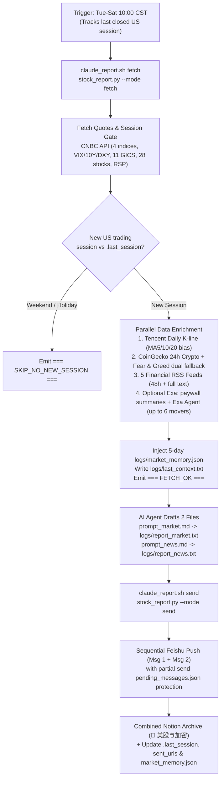

# 🗽 US Stock & Crypto Close Bot

> [← Back to Daily Bots Root README](../README.md)

**Runs Tue–Sat at `10:00 CST` (following each US market close).** Generates a unified two-message briefing:
1. **Message 1 — US Close & 24h Crypto Dashboard**: Major indices, VIX/US10Y/DXY, MA5/MA20 moving-average bias, 11 GICS sector ETFs & top movers, 28-stock breadth, 24h core crypto prices (`BTC`/`ETH`/`SOL`/`BNB`/`XRP`/`HYPE`) + Fear & Greed Index, and a structured Decision Signal Dashboard.
2. **Message 2 — US Market Headlines**: Priority-ranked (5-star to 3-star) news briefing mirroring the AI Daily News format.

---

## Workflow Architecture



---

## Data Sources & Anti-Hallucination Safeguards

| Layer | Sources | Key Details |
| :--- | :--- | :--- |
| **US Equities & Macro** | CNBC Quote API | 4 major indices, VIX, US10Y (in yield & bp), DXY, 11 GICS sector ETFs + top components, 28 watchlist leaders, equal-weight `RSP` |
| **Technical Trend** | Tencent Finance Daily K (`fqkline`) | S&P 500, Nasdaq, and Dow MA5 / MA10 / MA20 & MA5 bias percentage |
| **24h Crypto** | CoinGecko + Alternative.me / CMC | `BTC`, `ETH`, `SOL`, `BNB`, `XRP`, `HYPE`, total market cap, BTC dominance, dual-fallback Fear & Greed Index |
| **Financial News** | 5 RSS Feeds (48h window) | CNBC Top News, CNBC Earnings, Dow Jones MarketWatch, Nasdaq Markets, Nasdaq Earnings (50-char quality gate + 7-day dedup) |
| **Optional Exa Enrichment** | `shared/bot_utils.py` | When `ENABLE_EXA_ENRICH=1`: fills short paywalled summaries via `/contents` + `/search`, and verifies up to 6 uncovered stock movers via 1 Exa Agent batch (`confirmed` / `absent` / `cannot_verify` schema) |

- **Session Idempotency**: Compares CNBC's reported close date against `logs/.last_session` to skip US market holidays and weekends automatically (`=== SKIP_NO_NEW_SESSION ===`).
- **5-Day Market Memory**: Persists recent sector rotation and decision signals in `logs/market_memory.json` for multi-day continuity.

---

## CLI Usage

```bash
# 1. Fetch US close quotes, MA trend, 24h crypto, RSS news & optional Exa catalysts
bash "us stock bot/claude_report.sh" fetch

# 2. (AI Agent drafts logs/report_market.txt and logs/report_news.txt)

# 3. Push both messages to Feishu, archive combined report to Notion
bash "us stock bot/claude_report.sh" send

# Health check (runs at 11:00)
bash "us stock bot/health_check.sh"
```

---

## Key Files & Environment Variables

- `stock_report.py` — Quote/crypto/news/Exa collector, session gate, dual-message delivery, and market memory
- `prompt_market.md` / `prompt_news.md` — Editorial specs for Message 1 (Dashboard) and Message 2 (Headlines)
- **Required Env Vars**: `FEISHU_WEBHOOK`
- **Optional Env Vars**: `ENABLE_EXA_ENRICH` (`0`/`1`), `EXA_API_KEY`, `EXA_AGENT_EFFORT` (`medium`), `COINGECKO_API_KEY`, `CMC_API_KEY`, `NOTION_ARCHIVE_API_KEY`, `NOTION_ARCHIVE_DATABASE_ID`, `HTTPS_PROXY`.
