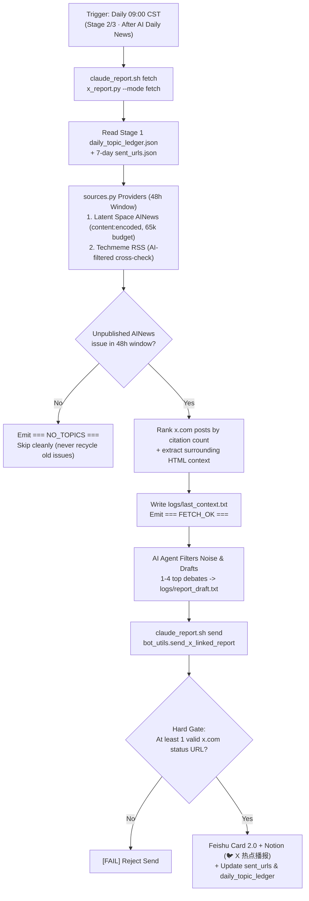

# 🐦 X Hotspot Bot

> [← Back to Daily Bots Root README](../README.md)

**Stage 2 of 3 in the daily `09:00 CST` AI intelligence pipeline.** Tracks the highest-signal AI engineering and product debates on X (Twitter) over a **48-hour window**, distills pro/con technical arguments, and enforces that every topic links directly to the single most-cited primary `x.com` post.

---

## Workflow Architecture



---

## Engineering Invariants (Do Not Break)

1. **Strict Primary Post Gate**: `run_send` delegates to `bot_utils.send_x_linked_report`, which refuses to publish (`[FAIL]`) if the draft contains zero `x.com/<user>/status/<id>` URLs.
2. **48-Hour Window by Design**: Discussions on X typically peak over 24–48 hours; the default window is `X_BOT_WINDOW_H=48` (do not shrink to 24h).
3. **Citation Count != Likes**: `sources._rank_posts` ranks primary posts by how many times they are cited in the daily AINews recap (a proxy for discussion centrality). Never mislabel citation counts as likes.
4. **Full `content:encoded` Extraction**: AINews RSS `summary` omits primary post links; `_entry_html` requires `content:encoded` length > 2000 chars to prevent silent degradation.
5. **Anchor-Element Context Replacement**: When extracting snippet context around each `x.com` URL in `sources.py`, the entire `<a ...>...</a>` element is replaced before stripping HTML tags so context strings never collapse to empty strings.
6. **Loud Provider Failure**: 3 consecutive zero-yield days emit `=== SOURCE_ALERT ===` rather than silently falling back to lower-quality sources.

---

## CLI Usage

```bash
# 1. Fetch 48h Latent Space [AINews] + Techmeme context
bash x-hotspot-bot/claude_report.sh fetch

# 2. (AI Agent drafts logs/report_draft.txt following prompt.md)

# 3. Validate primary x.com link gate, push to Feishu, archive to Notion
bash x-hotspot-bot/claude_report.sh send

# Optional: Syntax & context non-empty smoke check
python3 -m py_compile x-hotspot-bot/x_report.py x-hotspot-bot/sources.py
bash x-hotspot-bot/health_check.sh
```

---

## Key Files & Environment Variables

- `sources.py` — Pluggable provider layer (`fetch_ainews`, `fetch_techmeme`, citation ranking, context extraction)
- `x_report.py` — CLI orchestration, dual deduplication (issue URL + `x.com` status URLs), and delivery
- `prompt.md` — Editorial spec (1–4 high-centrality debates, inline attribution links, single most-cited `原帖：` link per topic)
- **Env Vars**: `FEISHU_WEBHOOK` (required), `X_BOT_WINDOW_H` (optional, default `48`), `NOTION_ARCHIVE_API_KEY` & `NOTION_ARCHIVE_DATABASE_ID` (optional), `HTTPS_PROXY` (optional).
